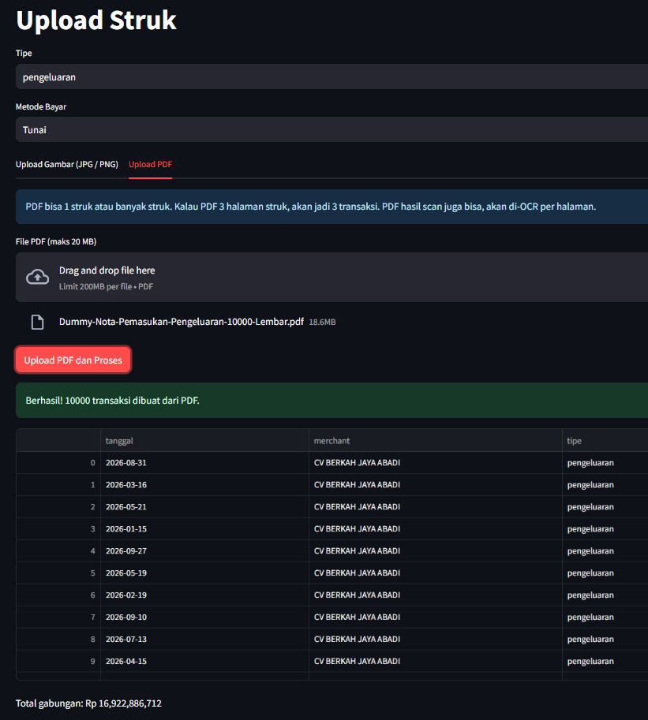

# Mini OCR Finance

Aplikasi mini untuk mengubah foto struk menjadi data pemasukan dan pengeluaran, lalu otomatis jadi laporan bulanan.

Upload foto struk -> AI OCR baca datanya -> simpan ke database -> tampil di dashboard dan laporan bulanan.

<p align="left">

</p>

## Fitur Utama

- Auth login dengan JWT, register dan login
- Upload struk pemasukan dan pengeluaran
- AI OCR untuk ekstrak tanggal, merchant, total, item, dan metode bayar
- Edit hasil OCR sebelum disimpan, untuk koreksi kalau AI salah baca
- Dashboard ringkasan harian dan bulanan
- Laporan bulanan per kategori, per merchant, dan per metode bayar
- Filter transaksi berdasarkan tanggal, kategori, dan tipe
- Export laporan ke CSV
- Semua jalan dengan Docker Compose

## Tech Stack

- Frontend: Streamlit
- Backend: FastAPI
- Database: PostgreSQL 16
- ORM: SQLAlchemy
- Auth: JWT + Bcrypt
- OCR: Service terpisah, bisa pakai API Vision atau Tesseract lokal
- Container: Docker dan Docker Compose

## Arsitektur

```
User -> Streamlit (Port 8501)
Streamlit -> FastAPI (Port 8000) via REST API + JWT
FastAPI -> PostgreSQL (Port 5432)
FastAPI -> OCR Service
FastAPI -> Folder uploads/ untuk simpan foto struk
```

Streamlit hanya tampilan. Semua logika hitung, auth, dan OCR ada di FastAPI.

## Prasyarat

- Docker dan Docker Compose sudah terinstall
- Git
- Koneksi internet untuk pull image dan panggil API OCR kalau pakai API

## Cara Install

```bash
git clone https://github.com/anggrdwjy/mini-ocr-finance.git
cd mini-ocr-finance
cp .env.example .env
```

Edit file `.env` dan isi nilai yang wajib, contoh JWT_SECRET dan API key OCR kalau pakai API.

## Konfigurasi .env

Buat random password dari openssl :

```
openssl rand -base64 32 (32 karakter random)

Hasil :
Cy0TO8SytowkjmDuSH36pel7kCuqs2F5mGZIiEcUBLw=

openssl rand -base64 16 (16 karakter random)

Hasil :
GXQqA56XrqvQwOv99x4HxA==
```

Buat file `.env` dari contoh ini:

```env
DB_USER=ocruser
DB_PASSWORD=ubah_ini
DB_NAME=ocr_finance
JWT_SECRET=secret_acak_panjang_minimal_32_karakter
OCR_PROVIDER=api_vision
OCR_API_KEY=isi_kalau_pakai_api
```

Jangan commit file `.env` ke Git. File ini hanya untuk lokal dan server.

## Cara Menjalankan

```bash
docker compose up --build
docker compose up --build -d (daemon running)
```

Tunggu sampai semua service jalan, lalu buka:

- Frontend: http://localhost:8501
- Backend docs: http://localhost:8000/docs
- Database: localhost:5432

Untuk stop:

```bash
docker compose down
```

Untuk reset database dan hapus data:

```bash
docker compose down -v
```

## Cara Pakai

1. Buka frontend di http://localhost:8501
2. Register akun baru di halaman login
3. Login dengan email dan password
4. Buka halaman Upload, upload foto struk
5. Cek hasil OCR, edit tanggal, total, atau kategori kalau ada yang salah
6. Simpan transaksi
7. Buka Dashboard untuk lihat ringkasan
8. Buka Laporan Bulanan, pilih bulan dan tahun, lalu download CSV kalau perlu


## Struktur Folder

```text
mini-ocr-finance/
├── docker-compose.yml
├── .env.example
├── README.md
├── backend/
│   ├── Dockerfile
│   ├── requirements.txt
│   └── app/
│       ├── main.py
│       ├── config.py
│       ├── database.py
│       ├── models.py
│       ├── schemas.py
│       ├── auth.py
│       ├── routers/
│       │   ├── auth.py
│       │   ├── transactions.py
│       │   └── reports.py
│       └── services/
│           ├── ocr_service.py
│           ├── categorizer.py
│           └── report_service.py
├── frontend/
│   ├── Dockerfile
│   ├── requirements.txt
│   ├── app.py
│   └── pages/
│       ├── 1_Upload.py
│       ├── 2_Dashboard.py
│       └── 3_Laporan_Bulanan.py
└── uploads/
```

## Database

Tabel inti:

- users: id, email, password_hash, nama, created_at
- categories: id, nama, tipe, warna
- transactions: id, user_id, tanggal, merchant, tipe, total, metode_bayar, kategori_id, receipt_path, confidence, status
- transaction_items: id, transaction_id, nama_item, qty, harga, subtotal

Relasi: satu user punya banyak transaksi, satu transaksi punya banyak item.

#### Support

* [:octocat: Follow me on GitHub](https://github.com/anggrdwjy)
* [🔔 Subscribe me on Youtube](https://www.youtube.com/@anggarda.wijaya)
  
## Lisensi

Proyek ini dilisensikan di bawah **MIT License** — bebas dipakai, diubah, dan dibagikan, termasuk untuk keperluan komersial, selama menyertakan pemberitahuan hak cipta dan lisensi ini.

Lihat file lengkapnya di [`LICENSE`](LICENSE).
